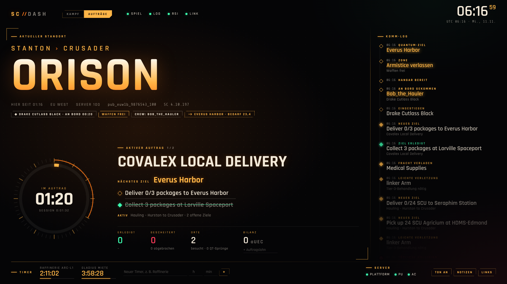
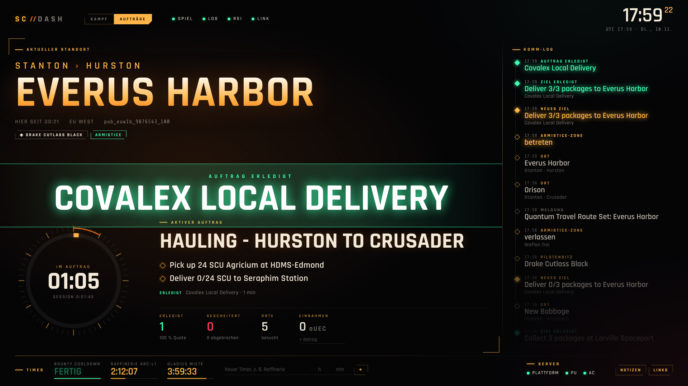

# SC-Dash

**Ein schlankes Second-Screen-Dashboard für Star Citizen – ohne Grafikkarten-Last.**

[](https://github.com/phantom-35/starcitizen-dash/actions/workflows/tests.yml)


SC-Dash liest die `Game.log` von Star Citizen live mit und zeigt dir auf dem zweiten Monitor
in Cockpit-HUD-Optik, was gerade zählt. Zwei Modi, umschaltbar oben links oder mit der Taste `M`:

**⚔ Kampf & Überleben** – wo du bist, wie lange du schon überlebst, Tode, K.O., Verletzungen,
CrimeStat, Med-Bed und wie du zuletzt gestorben bist.


**◈ Aufträge** – dein aktiver Auftrag mit allen Zielen als Checkliste, weitere laufende Aufträge,
Zonen-Status (Armistice, überwachter Raum, Jurisdiktion), dein Schiff, Komm-Log und Session-Bilanz.



<details>
<summary>Einblendungen bei Kills, Toden und Aufträgen</summary>

Bei Kills, Toden, angenommenen, erledigten und gescheiterten Aufträgen blendet SC-Dash für ein paar
Sekunden einen großen Hinweis ein:



</details>

---

## Warum „ohne GPU-Last“?

Star Citizen braucht jedes Megabyte Grafikspeicher – gerade auf Karten mit 8 GB wie einer RTX 4060.
Ein typisches Overlay oder ein Browser-Tab mit Animationen kann dort schnell 200–500 MB VRAM belegen.
SC-Dash ist darauf ausgelegt, das zu vermeiden:

| Maßnahme | Effekt |
|---|---|
| Dashboard-Fenster startet mit `--disable-gpu` (Software-Rendering) | **Kein VRAM** für das Dashboard, die Grafikkarte gehört dem Spiel (mit `--gpu` abschaltbar) |
| Eigenes, schlankes Browser-Profil ohne Erweiterungen | wenig RAM, keine Hintergrund-Tabs |
| Hintergrund, Glow und Raster sind statisch; Animationen nur für die Kill-Einblendung und kleine Statuspunkte | winzige Neuzeichnungen, kein Dauer-Rendering |
| Keine Bilder, Videos, Canvas oder WebGL; Schriften lokal mitgeliefert (~60 KB) | lädt sofort, funktioniert offline |
| Daten werden alle 2 s abgefragt, neu gezeichnet nur bei Änderungen | praktisch keine CPU-Last |
| Polling pausiert, wenn das Fenster minimiert ist | 0 Aufwand, wenn du es nicht siehst |
| Backend: reines Python, keine Abhängigkeiten | ~30 MB RAM, kein Node, kein Electron |

> **Ehrlicher Hinweis:** Ganz ohne GPU geht es unter Windows nie – der Desktop-Compositor (DWM)
> stellt jedes Fenster dar, auch das Dashboard. Das sind aber nur wenige MB und sie fallen auch an,
> wenn z. B. Discord oder der Explorer auf dem zweiten Monitor offen ist.

SC-Dash ist **kein Overlay** und greift nicht ins Spiel ein. Es liest nur eine Textdatei, die das
Spiel ohnehin schreibt. Damit gibt es keinen Konflikt mit Easy Anti-Cheat.

---

## Funktionen

### Immer sichtbar

- **Standort groß im Blick:** System › Planet und der Ort in Riesenschrift, Server-Region und Shard
- **Zonen-Status:** Armistice-Zone / Waffen frei, überwachter / unüberwachter Raum, Jurisdiktion
  (gesetzloser Raum rot), Sperrgebiet, Privatgelände
- **Quantum-Ziel**, solange ein Sprung geplant ist – lesbar statt interner IDs: Städte, Raststationen
  (*CRU-L4*), *Markierter Navpunkt*, *Partymitglied* und bei Auftragsmarkern der Ort aus dem aktiven
  Auftragsziel (*Auftragsziel · Clear View Emergency Shelter*)
- **Aktuelles Schiff mit Zeit an Bord und Frachtraum** (z. B. *RSI Aurora Mk II · an Bord 12:34 · 2 SCU*)
  und **Crew an Bord**. Der Schiffsname kommt notfalls auch aus den Quantum-Zeilen.
- **Wie viel Tank der geplante Quantum-Sprung braucht**, in Prozent des Quantum-Tanks deines Schiffs
  (z. B. *⟶ ArcCorp · braucht 42 % Tank*). Rot mit „reicht nicht!“, wenn die Route mehr als einen
  vollen Tank braucht; gelber Hinweis „Tankstand prüfen“, wenn Bedarf plus der Verbrauch dieser
  Session über 100 % liegen. Dazu der Verbrauch der Session („x % QT-Tank verflogen“).
  Wie das gerechnet wird, steht unter [Schiffsdaten und Treibstoff-Rechnung](#schiffsdaten-und-treibstoff-rechnung).
- **Server-Nummer** neben der Region – praktisch, um mit Freunden auf denselben Server zu kommen
- **Signaltöne** (Taste `T` oder Knopf „Ton an/aus“): kurzer Ton bei Tod, K.O., erledigtem/gescheitertem
  Auftrag, Verbindungsfehler und fertigem Timer – damit du es merkst, während du ins Spiel schaust
- **Verbindungsfehler** (z. B. 30000 Zeitüberschreitung) mit Klartext-Bedeutung
- **Timer** mit Fortschrittsbalken (Raffinerie, Miete, Cooldowns – laufen auch nach Neustart weiter)
- **RSI-Serverstatus**, **Notizen & Links** (Tasten `N` / `L`)
- **Lokal & privat:** Alles läuft auf deinem PC (`127.0.0.1`). Die einzige Internetanfrage ist der
  RSI-Serverstatus – abschaltbar mit `--no-status`.

### Modus „Aufträge“ (`M`)

- **Aktiver Auftrag** groß mit allen Zielen als Checkliste – offene oben, erledigte durchgestrichen.
  Im Fokus steht immer der Auftrag, an dem du zuletzt etwas gemacht hast.
- **Nächstes Ziel:** der Ort aus dem ersten offenen Ziel (Abholen vor Abliefern) – mit Markierung
  **„du bist hier“**, sobald du dort angekommen bist
- **Fortschrittsbalken** bei Mengen-Zielen (*Deliver 8/24 SCU …*) und der Abgleich mit deinem
  Frachtraum: *„passt in einen Flug“* oder *„12 Flüge nötig (Frachtraum 2 SCU, offen 24 SCU)“*
- **Fracht verladen / abgegeben:** jede Kiste, die du ins Schiff stellst oder am Ziel abgibst
- **Weitere laufende Aufträge** und die zuletzt erledigten / gescheiterten mit Dauer
- **Ring „Im Auftrag“:** wie lange du schon am aktuellen Auftrag sitzt
- **Session-Statistik:** erledigt, gescheitert, Erfolgsquote, durchschnittliche Dauer, besuchte Orte
- **Bilanz:** Einkäufe (Shops, Fracht, Treibstoff), Strafen und Überweisungen rechnet SC-Dash
  automatisch ein. Nur den Auftragslohn tippst du selbst ein (`25k` + Enter) – den schreibt das Spiel
  nicht in die Log. Startet mit jeder Spielsitzung bei 0.
- **Geld & Handel im Komm-Log:** erhaltene/gesendete aUEC, fertige Raffinerie-Aufträge, Belohnungen, Blueprints
- **Komm-Log:** alle Spielmeldungen (Aufträge, Ziele, Zonen, Quantum-Routen …). Auch HUD-Meldungen,
  die SC-Dash nicht genauer einordnen kann, landen hier.

### Modus „Kampf & Überleben“

> **Wichtig:** Seit etwa Version 4.4 schreibt Star Citizen **keine Abschüsse mehr** in die `Game.log`
> (Kills und Wallet laufen jetzt serverseitig). Kein Log-Tool kann deine Kills in aktuellen Versionen
> zählen. SC-Dash zeigt deshalb, was das Spiel weiterhin protokolliert – und Kills nur dann, wenn
> eine ältere Version sie liefert.

- **Zustand:** offene Verletzungen mit Körperteil und nötiger Med-Bed-Stufe – verschwinden nach der
  Behandlung im Med-Bed bzw. beim Tod. So siehst du auf einen Blick, ob du erst zum Arzt solltest.
- **Am-Leben-Chronometer:** wie lange du seit deinem letzten Tod überlebst, plus längstes Überleben der Session
- **Tode** – jeder Tod zählt genau einmal, auch wenn das Spiel mehrere Zeilen dazu schreibt
- **K.O. (kampfunfähig)**, **Verletzungen** (mit Körperteil und Behandlungsstufe), **CrimeStat-Erhöhungen**
- **Med-Bed-Behandlungen** und **tödliche Kollisionen** als Pilot
- **Letzter Tod:** z. B. *„Drake Cutlass Black – Schiff zerstört · Daymar · vor 4 min“*
- **Einblendung** bei Tod, K.O., CrimeStat, Beschlagnahmung und Sperrgebiet
- **Ereignis-Zeitleiste** mit lesbaren Namen (*Drake Cutlass Black* statt `DRAK_Cutlass_Black_8471923`)
- **Kills / K/D** erscheinen automatisch, falls die Log welche enthält (Versionen bis ~4.3)

---

## Installation (Windows)

1. **Python 3.10 oder neuer** installieren: <https://www.python.org/downloads/>
   → beim Installieren den Haken bei **„Add python.exe to PATH“** setzen.
2. Dieses Repository herunterladen: grüner Button **Code → Download ZIP** und entpacken
   (oder `git clone https://github.com/phantom-35/starcitizen-dash.git`).
3. **`start.bat`** doppelklicken.

Das war's. Ein Konsolenfenster zeigt Statusmeldungen, und das Dashboard öffnet sich als eigenes
Fenster (Edge oder Chrome im App-Modus). Zieh es auf den zweiten Monitor und drück ggf. `F11` für
Vollbild. Edge ist auf jedem Windows vorhanden, es muss also nichts weiter installiert werden.

Erst mal ohne Spiel ausprobieren? → **`demo.bat`** starten, das simuliert Ereignisse.

### Wo liegt meine Game.log?

SC-Dash liest den Installationsordner aus der Log des RSI-Launchers und sucht zusätzlich auf allen
Laufwerken in den üblichen Ordnern, z. B.

```
C:\Program Files\Roberts Space Industries\StarCitizen\LIVE\Game.log
D:\Roberts Space Industries\StarCitizen\PTU\Game.log
```

und nimmt die zuletzt geänderte. Wird nichts gefunden (Chip **„KEINE GAME.LOG“** oben im
Dashboard), gib den Ordner einfach an:

```bat
start.bat --log "E:\Spiele\StarCitizen\LIVE"
```

Tipp: Im RSI-Launcher unter *Settings → Games* steht dein Installationspfad.

---

## Optionen

```
python -m scdash [Optionen]

  --log PFAD     Game.log oder Kanal-Ordner (LIVE/PTU/…) – Standard: automatische Suche
  --open         Dashboard-Fenster öffnen (Edge/Chrome, App-Modus, GPU aus)
  --port 8777    Port des lokalen Webservers
  --host ADRESSE Standard 127.0.0.1 (nur dieser PC). Mit 0.0.0.0 z. B. vom Tablet/Handy
                 im WLAN erreichbar – dann auf http://<PC-IP>:8777 öffnen.
  --gpu          Dashboard-Fenster mit Hardwarebeschleunigung (etwas flüssiger, belegt aber VRAM)
  --no-status    RSI-Serverstatus nicht abrufen (keine Internetzugriffe)
  --demo         Demo-Modus mit simulierten Ereignissen
  -v             Ausführliche Ausgabe
```

**Dashboard auf Tablet oder Handy:** Mit `start.bat --host 0.0.0.0` kannst du das Dashboard auf
einem anderen Gerät im Heimnetz öffnen – dann belastet es deinen Gaming-PC grafisch überhaupt nicht.
Windows fragt beim ersten Mal nach einer Firewall-Freigabe (nur „Private Netzwerke“ erlauben).

**Eigener Browser statt `--open`:** Einfach <http://127.0.0.1:8777> öffnen. Damit dein Browser
keinen Grafikspeicher nutzt, in dessen Einstellungen die *Hardwarebeschleunigung* deaktivieren –
oder lieber `--open` verwenden, das macht genau das, ohne deinen normalen Browser zu verändern.

**Modus per Link:** `http://127.0.0.1:8777/?mode=mission` bzw. `?mode=combat` öffnet direkt im
gewünschten Modus (praktisch für Lesezeichen). Sonst merkt sich SC-Dash den zuletzt gewählten Modus.

**Links anpassen:** `scdash/web/links.json` bearbeiten.

**Monitorgrößen:** Das Layout skaliert von 1366×768 bis 4K mit. Auf Hochkant-Monitoren werden die
Bereiche untereinander angeordnet. Vollbild mit `F11`.

---

## Was wird erkannt?

Stand: geprüft gegen eine echte `Game.log` von **Star Citizen 4.10** (ein anonymisierter Auszug liegt
als Testfall in `tests/fixtures/`).

| Ereignis | Log-Eintrag | Geprüft mit 4.10 |
|---|---|:-:|
| Login / Pilotenname | `User Login Success - Handle[…]` | ✅ |
| Shard & Region | `<Join PU> … shard[…]` | ✅ |
| Spielversion | `ProductVersion: …` | ✅ |
| Ortswechsel | `<RequestLocationInventory> … Location[…]`; zusätzlich Quantum-Ankunft an einem bekannten Ort und `Projected Start Location is …` | ✅ |
| Ortsnamen (Raststationen, Außenposten, Gateways) | interne IDs wie `RR_HUR_LEO`, `Outpost_…`, `RR_JP_…` | ✅ / 📚 |
| Aufträge & Ziele | `<SHUDEvent_OnNotification> Added notification "Contract Accepted: …"`, `New Objective`, `Objective Complete`, `Contract Complete/Failed` | ✅ |
| Ziel-Status | `<ObjectiveUpserted> … state MISSION_OBJECTIVE_STATE_COMPLETED` | ✅ |
| Auftragsende | `<MissionEnded> … mission_state …`, `<EndMission> … CompletionType[…]` | ✅ |
| Zonen | Meldungen *Armistice Zone*, *Monitored Space*, *… Jurisdiction* | ✅ |
| Schiff (ein-/aussteigen) | Meldung `You have joined channel '<Schiff> : <Pilot>'` | ✅ |
| Quantum-Ziele & Sprünge | `<Player Selected Quantum Target …>`, `<Player Requested Fuel to Quantum Target …>`, `<Quantum Drive Arrived …>` | ✅ |
| Treibstoffbedarf der Route | `…CalculateRoute\|Successfully calculated route to … fuel estimate 16.858223` | ✅ |
| Quantum blockiert | Meldung *Quantum Travel: Your destination is obstructed …* | ✅ |
| Spiel beendet | `<SystemQuit>` | ✅ |
| Session-Start | Zeitstempel der ersten Log-Zeile | ✅ |
| Hangar, Kanäle, Blueprints | HUD-Meldungen | ✅ |
| Fracht verladen / abgegeben | `<[ActorState] Place> … DoPlace] '…' placed '…Commodity_…' in lootable container '…'` | ✅ |
| Verbindungsabbrüche | `<Channel Disconnected> cause=N reason="…"` (30010/30016/30028 sind normale Abmeldungen) | ✅ / 📚 |
| Einkäufe | `…BuyRequest> Sending … shopName[…] client_price[…] itemName[…] quantity[…]` bzw. `price[…]` bei Fracht | 📚 |
| Crew an Bord | Meldung *New Member Joined X has joined channel '<Schiff> : <Pilot>'* / *Member Left …* | 📚 |
| Spiel läuft | Prozess `StarCitizen.exe` (Pfad aus der Log: `…\LIVE\Bin64\StarCitizen.exe`) | ✅ |
| Installationsordner | Log des RSI-Launchers (`%APPDATA%\rsilauncher\logs\log.log`) und übliche Ordner | 📚 |
| Eigener Tod | `<[ActorState] Dead> … Actor '…' … ejected from zone '…' … to zone '…'`, `<[ActorState] Corpse>` | 📚 |
| Kampfunfähig (K.O.) | `Logged an incap.! nickname: …, causes: […]`, Meldung *Incapacitated* | 📚 |
| Verletzungen | Meldung *Minor/Moderate/Severe Injury Detected - <Körperteil> - Tier N* | 📚 |
| Med-Bed | `<MED BED HEAL> … Perform surgery event Success, med bed name: …, vehicle name: …` | 📚 |
| Tödliche Kollision | `Fatal Collision occured for vehicle … PlayerPilot: 1` | 📚 |
| CrimeStat, Straftaten, Strafen, Beschlagnahmung | HUD-Meldungen | 📚 |
| Geld, Raffinerie, Belohnungen | HUD-Meldungen *… has sent you: N aUEC*, *A Refinery Work Order has been Completed at …* | 📚 |
| Sperrgebiet, Privatgelände, Überwachung aus | HUD-Meldungen | 📚 |
| Kills & Schiffszerstörung | `<Actor Death> CActor::Kill`, `<Vehicle Destruction>` | 🕰 nur bis ~4.3 |

✅ = mit einer echten 4.10-Log geprüft · 📚 = laut Quellen unten in 4.x so geloggt, in der geprüften
Session nicht vorgekommen (Tests mit nachgebauten Zeilen) · 🕰 = in aktuellen Versionen nicht mehr in der Log

Grundsatz: Jede Erkennungsregel ist entweder in einer echten Log gesehen oder in einem der Projekte
unten belegt. Geratene Formulierungen gibt es nicht – lieber landet eine Meldung unerkannt im Komm-Log.

### Quellen

Es gibt keine offizielle Dokumentation der `Game.log`. Die Formate oben stammen aus deiner echten Log
und wurden mit dem Quellcode quelloffener Projekte abgeglichen, die mit echten Logs arbeiten:

- [sc-log-tracker](https://github.com/DefaultHahn/sc-log-tracker) (MIT) – getestet mit 238 Sessions
  von 4.3 bis 4.10; Quelle für Tod, Verletzungen, Recht, Geld, Ortsnamen (Raststationen, Außenposten,
  Gateways), Server-Regionen, Herstellerkürzel, die Einordnung der Quantum-Ziele und die Suche des
  Installationsordners über die Launcher-Log
- [csr](https://github.com/archelium/csr) – „tested on 4.1 → 4.10“; Tod, Med-Bed, Kollisionen
- [all-slain](https://github.com/DimmaDont/all-slain) (MIT) – Formate für K.O., Leiche/Respawn, Med-Bed;
  dokumentiert, dass Kill-Zeilen seit 4.0.2 nur noch den eigenen Spieler betreffen
- [StarLogs](https://github.com/Ozy311/StarLogs) – Kill- und Fahrzeug-Zeilen älterer Versionen

Wenn dir eines der 📚-Ereignisse passiert, schick gern die Zeile aus deiner `Game.log` – dann wird
daraus ein ✅ mit echtem Testfall.

### Wie das Live-Mitlesen funktioniert

Star Citizen hat keine Schnittstelle für Drittprogramme – die `Game.log` ist die einzige Quelle.
SC-Dash liest sie deshalb so vorsichtig und robust wie möglich:

- **Zweimal pro Sekunde** wird nur der neu hinzugekommene Teil gelesen (bis zum echten Dateiende,
  nicht nach der gemeldeten Dateigröße – die hinkt unter Windows manchmal hinterher).
- Die Datei wird **nur kurz** und mit voller Freigabe geöffnet. Das Spiel kann sie jederzeit
  weiterschreiben, verschieben oder ersetzen.
- **Halbe Zeilen** (das Spiel schreibt gerade) werden zurückgehalten, bis sie vollständig sind.
- **Mehrzeilige Meldungen** werden wieder zusammengesetzt (manche HUD-Texte enthalten einen Zeilenumbruch).
- **Spiel-Neustart** wird an Datei-Identität, Größe und der ersten Zeile erkannt → neue Session.
- Über 95 % der Zeilen sind uninteressant und werden mit einer einzigen Prüfung übersprungen:
  eine komplette 1-Stunden-Log (1 MB) ist in ca. 15 ms ausgewertet.
- Das Dashboard hält eine Anfrage offen, und der Server antwortet **sofort, wenn etwas passiert**
  (Long-Polling). Ein Ereignis ist so nach höchstens einer halben Sekunde auf dem Bildschirm – ohne
  dass im Leerlauf ständig abgefragt wird.
- Bei sehr langen Logs (> 8 MB) wird nur das Ende ausgewertet; Pilot, Shard und Version holt
  SC-Dash trotzdem vom Anfang der Datei.
- Läuft das Dashboard auf einem Tablet mit falsch gehender Uhr, werden alle Zeiten mit der Uhr des
  Gaming-PCs abgeglichen.

**Getestet** (automatisch, unter Windows und Linux): Dashboard läuft vor dem Spiel; Spiel schreibt
halbe Zeilen und umgebrochene Meldungen; Spiel-Neustart verschiebt die Log nach `logbackups`;
Log wird überschrieben; deine komplette Log wird in zufälligen Häppchen „live“ nachgespielt und muss
dasselbe ergeben wie am Stück gelesen. Ein Dauertest mit 50-facher Ereignisrate lief bei 0,2 % CPU
und 22 MB RAM ohne Fehler im Browser.

Ob das Spiel läuft, wird zusätzlich alle 15 s über die Prozessliste geprüft.

> Das Log-Format ist nicht offiziell dokumentiert und ändert sich gelegentlich mit Patches. Wenn
> etwas nicht (mehr) erkannt wird, bitte ein Issue mit der betreffenden Log-Zeile öffnen. Meldungen,
> die SC-Dash nicht einordnen kann, erscheinen trotzdem im Komm-Log.

---

## Schiffsdaten und Treibstoff-Rechnung

Frachtraum und Größe des Quantum-Tanks stehen nicht in der `Game.log`. SC-Dash bringt dafür eine
kleine Schiffsdatenbank mit (`scdash/data/ships.json`, 310 Fahrzeuge, Stand siehe Datei). Sie wird
mit `tools/build_ship_data.py` erzeugt – das Dashboard selbst geht dafür nie online.

**Woher die Werte kommen.** Aus den Spieldateien ([scunpacked-data](https://github.com/StarCitizenWiki/scunpacked-data)),
abgeglichen mit der [Wiki-API](https://api.star-citizen.wiki), [FleetYards](https://fleetyards.net/)
und [UEX](https://uexcorp.space/). Regeln:

- Ein Wert wird nur übernommen, wenn **mindestens zwei Quellen übereinstimmen**.
- Spieldateien und Wiki-API haben dieselbe Herkunft. „Unabhängig bestätigt“ ist ein Wert erst, wenn
  auch FleetYards oder UEX ihn nennt (Quantum-Tank: 171 Schiffe, Frachtraum: 226). Alle anderen zeigt
  SC-Dash mit **„ca.“** an.
- **Widersprüche werden nicht geglättet:** Nennt die Mehrheit 0 SCU und eine Quelle mehr (modulare
  Schiffe wie die Retaliator), zeigt SC-Dash gar keinen Wert.
- Die offizielle RSI-Schiffsliste wird nur verglichen, nicht verwendet – sie weicht bei 13 Schiffen
  vom Spiel ab (Aurora Mk II: 5 SCU laut Liste, 2 SCU im Spiel).

Der vollständige Abgleich steht in [docs/ship-data-report.md](docs/ship-data-report.md).

**Wie der Treibstoff gerechnet wird.** Bei jeder Routenplanung schreibt das Spiel
`fuel estimate 18.180450` in die Log. Die Einheit ist nirgends dokumentiert – sie wurde deshalb an
einer echten Session nachgerechnet:

| | |
|---|---|
| Quantum-Tank Aurora Mk II | 0,9 SCU (Spieldateien: 900 Einheiten zu je 1/1000 SCU) |
| Reichweite mit Standard-Antrieb | 98,75 Gm → 9,11 Einheiten pro Gm |
| Sprung zwischen zwei Auftragsorten auf microTech | Luftlinie 1.750 km, über die Oberfläche 2.131 km (Koordinaten aus der Log) |
| Schätzung des Spiels dafür | 18,18 |
| als **Millionstel SCU** gelesen | **1.995 km** – liegt genau dazwischen ✔ |
| als Tausendstel SCU gelesen | 1.994.783 km – auf einem Planeten mit 2.000 km Durchmesser unmöglich ✘ |

Ein zweiter Sprung (17,70 → 1.942 km bei 1.783 / 2.202 km) bestätigt das, ebenso der Referenzwert der
Wiki (Port Olisar → ArcCorp: 382 Einheiten für ~42 Gm). Also gilt:

> **Anteil am Tank = Schätzung × 0,000001 SCU ÷ Tankgröße des Schiffs**

Der Anteil hängt nicht vom eingebauten Quantum-Antrieb ab: Dessen Verbrauch steckt bereits in der
Schätzung des Spiels. Diese Rechnung ist als Test im Projekt festgehalten (`tests/test_ships.py`).

**Was das nicht ist:** kein Tankinhalt. SC-Dash weiß nicht, wie voll dein Tank ist und wann du
getankt hast – es kennt nur den Bedarf der geplanten Route und die Summe der geflogenen Sprünge.
Kurze Sprünge auf einem Planeten brauchen weit unter 0,1 % und werden als „< 0,1 %“ angezeigt.

## Log-Check und der Versuch „ausführlichere Log“

```bat
python -m scdash --analyze "C:\…\StarCitizen\LIVE\Game.log"
python -m scdash --analyze neu.log --compare alt.log
```

Der Bericht zeigt, was SC-Dash in einer Log erkennt, welche HUD-Meldungen noch keine eigene Regel
haben und welche Zeilenarten vorkommen. Spielername, IDs und Adressen sind unkenntlich gemacht – du
kannst ihn bedenkenlos weitergeben (z. B. in einem Issue).

**Versuch: schreibt das Spiel auf Wunsch mehr in die Log?** Die Engine kennt die Einstellungen
`log_verbosity` und `log_WriteToFileVerbosity`
([Liste im Star Citizen Wiki](https://starcitizen.tools/User:Astrid/sandbox/cvars/extended)). Ob die
normale Spielversion sie zulässt, ist nicht dokumentiert – aber gefahrlos prüfbar, denn das Spiel
schreibt bei jeder nicht erlaubten Einstellung selbst `is marked [Not Whitelisted] … - IGNORING` in
die Log:

1. Alte Log sichern: `Game.log` aus dem Ordner `…\StarCitizen\LIVE` kopieren, z. B. als `alt.log`.
2. Im selben Ordner die Datei `user.cfg` öffnen (oder neu anlegen) und zwei Zeilen ergänzen:
   ```
   log_verbosity = 4
   log_WriteToFileVerbosity = 4
   ```
3. Spiel starten, ein paar Minuten spielen, beenden.
4. `python -m scdash --analyze "…\LIVE\Game.log" --compare alt.log`

Im Abschnitt „Ausführlichere Log“ steht dann **ABGELEHNT** (dann die zwei Zeilen wieder entfernen –
mehr geht nicht) oder **NICHT abgelehnt** mit dem Vergleich, wie viel mehr geschrieben wurde. Im
zweiten Fall bitte den Bericht als Issue schicken: Dann lässt sich prüfen, ob neue nützliche Daten
dabei sind.

## Was nicht geht – und warum

Star Citizen hat **keine Schnittstelle** für Live-Daten. Schilde, Hüllenschaden, Tankinhalt,
Geschwindigkeit, Munition oder Ladungsmenge stehen nicht in der `Game.log` und sind von außen nicht
erlaubt abrufbar. Alle „Star Citizen APIs“ liefern nur feste Daten (Schiffswerte, Handelspreise).
Andere Zweitbildschirm-Tools lesen ebenfalls die `Game.log` oder schicken nur Tastendrücke.

SC-Dash liest bewusst **nicht** den Arbeitsspeicher des Spiels aus (genau das soll Easy Anti-Cheat
verhindern – Risiko für den Account) und macht **keine** Bildschirmerkennung (kostet dauerhaft Leistung).

---

## Entwicklung

```bash
git clone https://github.com/phantom-35/starcitizen-dash.git
cd starcitizen-dash
python -m scdash --demo           # Demo starten → http://127.0.0.1:8777
python -m unittest discover -s tests -t . -v
```

Optional als Befehl installieren: `pip install .` → danach einfach `scdash --open`.

```
scdash/
├── cli.py        Kommandozeile, Start der Threads, Browserfenster
├── locations.py  Lesbare Namen für Orte, Server-Regionen, Schiffe und Waffen
├── ships.py      Schiffsdatenbank (Frachtraum, Quantum-Tank) und Treibstoff-Rechnung
├── analyze.py    Log-Check (--analyze): Bericht über eine Game.log
├── data/         ships.json – erzeugt von tools/build_ship_data.py
├── paths.py      Game.log finden (Launcher-Log, übliche Ordner), Browser für --open
├── parser.py     Erkennung der Log-Zeilen (reine Funktionen, gut testbar)
├── state.py      Thread-sicherer Zustand + Auswertung (Kills/Tode/…)
├── watcher.py    Game.log mitlesen, Spielprozess erkennen
├── status.py     RSI-Serverstatus (cState-JSON)
├── server.py     Mini-HTTP-Server: statische Dateien + /api/state
├── demo.py       Simulierte Game.log für den Demo-Modus
└── web/          index.html, style.css, app.js, links.json, fonts/
```

Beiträge sind willkommen – siehe [CONTRIBUTING.md](CONTRIBUTING.md). Änderungen stehen im
[CHANGELOG.md](CHANGELOG.md).

### Ideen für später

- Quantum-Travel- und Missions-Ereignisse, sobald stabile Log-Muster bekannt sind
- Session-Historie (Statistik über mehrere Abende)
- Kompakter Terminal-Modus (komplett ohne Browser)

---

## Rechtliches

SC-Dash ist ein inoffizielles Fan-Projekt und steht in keiner Verbindung zu Cloud Imperium Games
oder Roberts Space Industries. *Star Citizen®* ist eine eingetragene Marke von Cloud Imperium Rights LLC.

Lizenz: [MIT](LICENSE). Mitgelieferte Schriften: *Rajdhani* (Indian Type Foundry) und
*Share Tech Mono* (Carrois Type Design), beide unter der
[SIL Open Font License 1.1](scdash/web/fonts/).
