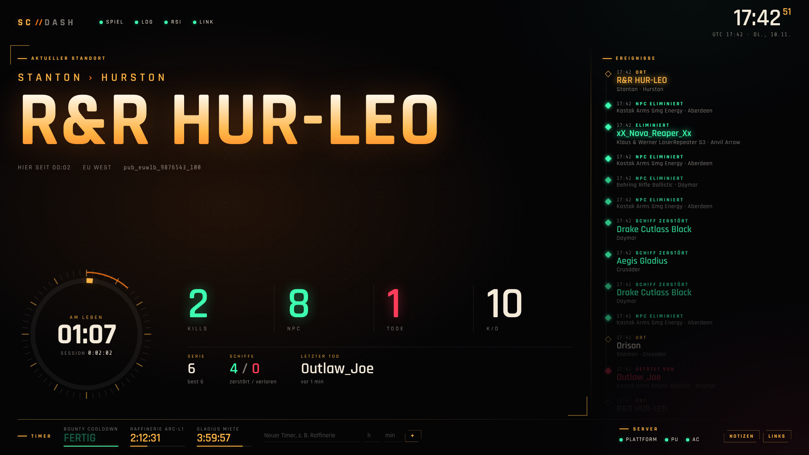
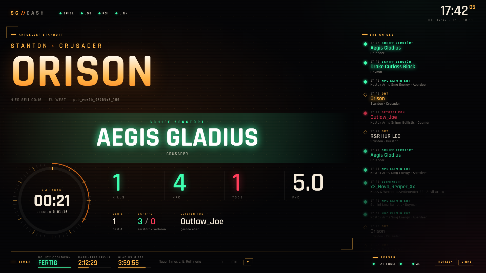

# SC-Dash

**Ein schlankes Second-Screen-Dashboard für Star Citizen – ohne Grafikkarten-Last.**

[](https://github.com/phantom-35/starcitizen-dash/actions/workflows/tests.yml)


SC-Dash liest die `Game.log` von Star Citizen live mit und zeigt dir auf dem zweiten Monitor
in Cockpit-HUD-Optik, was gerade zählt: **wo du bist, wie lange du schon überlebst, wer dich zuletzt
erwischt hat** – plus Kill-Statistik, Ereignis-Log, Timer für Raffinerie & Co. und den RSI-Serverstatus.



<details>
<summary>Kill-/Tod-Einblendung</summary>

Bei jedem Kill oder Tod blendet SC-Dash für ein paar Sekunden einen großen Hinweis ein:


</details>

---

## Warum „ohne GPU-Last“?

Star Citizen braucht jedes Megabyte Grafikspeicher – gerade auf Karten mit 8 GB wie einer RTX 4060.
Ein typisches Overlay oder ein Browser-Tab mit Animationen kann dort schnell 200–500 MB VRAM belegen.
SC-Dash ist darauf ausgelegt, das zu vermeiden:

| Maßnahme | Effekt |
|---|---|
| Dashboard-Fenster startet mit `--disable-gpu` (Software-Rendering) | **Kein VRAM** für das Dashboard, die Grafikkarte gehört dem Spiel (mit `--gpu` abschaltbar) |
| Eigenes, schlankes Browser-Profil ohne Erweiterungen | wenig RAM, keine Hintergrund-Tabs |
| Hintergrund, Glow und Raster sind statisch; Animationen nur für die Kill-Einblendung und kleine Statuspunkte | winzige Neuzeichnungen, kein Dauer-Rendering |
| Keine Bilder, Videos, Canvas oder WebGL; Schriften lokal mitgeliefert (~60 KB) | lädt sofort, funktioniert offline |
| Daten werden alle 2 s abgefragt, neu gezeichnet nur bei Änderungen | praktisch keine CPU-Last |
| Polling pausiert, wenn das Fenster minimiert ist | 0 Aufwand, wenn du es nicht siehst |
| Backend: reines Python, keine Abhängigkeiten | ~30 MB RAM, kein Node, kein Electron |

> **Ehrlicher Hinweis:** Ganz ohne GPU geht es unter Windows nie – der Desktop-Compositor (DWM)
> stellt jedes Fenster dar, auch das Dashboard. Das sind aber nur wenige MB und sie fallen auch an,
> wenn z. B. Discord oder der Explorer auf dem zweiten Monitor offen ist.

SC-Dash ist **kein Overlay** und greift nicht ins Spiel ein. Es liest nur eine Textdatei, die das
Spiel ohnehin schreibt. Damit gibt es keinen Konflikt mit Easy Anti-Cheat.

---

## Funktionen

- **Standort groß im Blick:** System › Planet und der Ort in Riesenschrift (z. B. *Stanton › Crusader – ORISON*),
  wie lange du schon dort bist, Server-Region (EU West, US East …) und Shard
- **Am-Leben-Chronometer:** Ring-Anzeige, wie lange du seit deinem letzten Tod überlebst, dazu die Session-Dauer
- **Kampfstatistik:** Spieler-Kills, NPC-Kills, Tode, K/D, aktuelle Kill-Serie und Bestwert,
  zerstörte/verlorene Schiffe, **wer dich zuletzt getötet hat**
- **Kill-/Tod-Einblendung:** großer Hinweis für ein paar Sekunden bei jedem Kill oder Tod
- **Ereignis-Zeitleiste:** Kills, Tode, Schiffszerstörungen, Ortswechsel – mit lesbaren Namen
  (*Drake Cutlass Black* statt `DRAK_Cutlass_Black_8471923`, *Behring …* statt `behr_rifle_…`)
- **Timer** mit Fortschrittsbalken, z. B. für Raffinerie-Jobs, Schiffsmieten oder Cooldowns – laufen auch nach Neustart weiter
- **RSI-Serverstatus:** Plattform / PU / Arena Commander (alle 5 min)
- **Notizen & Links** in einer ausfahrbaren Seitenleiste (Tasten `N` und `L`, `Esc` schließt)
- **Lokal & privat:** Alles läuft auf deinem PC (`127.0.0.1`). Die einzige Internetanfrage ist der
  RSI-Serverstatus – abschaltbar mit `--no-status`.

---

## Installation (Windows)

1. **Python 3.9 oder neuer** installieren: <https://www.python.org/downloads/>
   → beim Installieren den Haken bei **„Add python.exe to PATH“** setzen.
2. Dieses Repository herunterladen: grüner Button **Code → Download ZIP** und entpacken
   (oder `git clone https://github.com/phantom-35/starcitizen-dash.git`).
3. **`start.bat`** doppelklicken.

Das war's. Ein Konsolenfenster zeigt Statusmeldungen, und das Dashboard öffnet sich als eigenes
Fenster (Edge oder Chrome im App-Modus). Zieh es auf den zweiten Monitor und drück ggf. `F11` für
Vollbild. Edge ist auf jedem Windows vorhanden, es muss also nichts weiter installiert werden.

Erst mal ohne Spiel ausprobieren? → **`demo.bat`** starten, das simuliert Ereignisse.

### Wo liegt meine Game.log?

SC-Dash sucht automatisch auf allen Laufwerken in den üblichen Ordnern, z. B.

```
C:\Program Files\Roberts Space Industries\StarCitizen\LIVE\Game.log
D:\Roberts Space Industries\StarCitizen\PTU\Game.log
```

und nimmt die zuletzt geänderte. Wird nichts gefunden (Chip **„KEINE GAME.LOG“** oben im
Dashboard), gib den Ordner einfach an:

```bat
start.bat --log "E:\Spiele\StarCitizen\LIVE"
```

Tipp: Im RSI-Launcher unter *Settings → Games* steht dein Installationspfad.

---

## Optionen

```
python -m scdash [Optionen]

  --log PFAD     Game.log oder Kanal-Ordner (LIVE/PTU/…) – Standard: automatische Suche
  --open         Dashboard-Fenster öffnen (Edge/Chrome, App-Modus, GPU aus)
  --port 8777    Port des lokalen Webservers
  --host ADRESSE Standard 127.0.0.1 (nur dieser PC). Mit 0.0.0.0 z. B. vom Tablet/Handy
                 im WLAN erreichbar – dann auf http://<PC-IP>:8777 öffnen.
  --gpu          Dashboard-Fenster mit Hardwarebeschleunigung (etwas flüssiger, belegt aber VRAM)
  --no-status    RSI-Serverstatus nicht abrufen (keine Internetzugriffe)
  --demo         Demo-Modus mit simulierten Ereignissen
  -v             Ausführliche Ausgabe
```

**Dashboard auf Tablet oder Handy:** Mit `start.bat --host 0.0.0.0` kannst du das Dashboard auf
einem anderen Gerät im Heimnetz öffnen – dann belastet es deinen Gaming-PC grafisch überhaupt nicht.
Windows fragt beim ersten Mal nach einer Firewall-Freigabe (nur „Private Netzwerke“ erlauben).

**Eigener Browser statt `--open`:** Einfach <http://127.0.0.1:8777> öffnen. Damit dein Browser
keinen Grafikspeicher nutzt, in dessen Einstellungen die *Hardwarebeschleunigung* deaktivieren –
oder lieber `--open` verwenden, das macht genau das, ohne deinen normalen Browser zu verändern.

**Links anpassen:** `scdash/web/links.json` bearbeiten.

**Monitorgrößen:** Das Layout skaliert von 1366×768 bis 4K mit. Auf Hochkant-Monitoren werden die
Bereiche untereinander angeordnet. Vollbild mit `F11`.

---

## Was wird erkannt?

| Ereignis | Log-Eintrag |
|---|---|
| Login / Pilotenname | `User Login Success - Handle[…]` |
| Shard-Beitritt | `<Join PU> … shard[…]` |
| Ortswechsel | `<RequestLocationInventory> … Location[…]` |
| Kills & Tode | `<Actor Death> CActor::Kill: …` |
| Schiffszerstörung | `<Vehicle Destruction> …` |
| Spiel beendet | `<SystemQuit>` |

Startet das Spiel neu, legt es eine frische `Game.log` an – SC-Dash merkt das und beginnt eine neue
Session. Ob das Spiel läuft, wird zusätzlich alle 15 s über die Prozessliste geprüft.

> Das Log-Format ist nicht offiziell dokumentiert und ändert sich gelegentlich mit Patches. Wenn
> etwas nicht mehr erkannt wird, bitte ein Issue mit der betreffenden Log-Zeile öffnen.

---

## Entwicklung

```bash
git clone https://github.com/phantom-35/starcitizen-dash.git
cd starcitizen-dash
python -m scdash --demo           # Demo starten → http://127.0.0.1:8777
python -m unittest discover -s tests -t . -v
```

Optional als Befehl installieren: `pip install .` → danach einfach `scdash --open`.

```
scdash/
├── cli.py        Kommandozeile, Start der Threads, Browserfenster
├── locations.py  Lesbare Namen für Orte, Server-Regionen, Schiffe und Waffen
├── parser.py     Erkennung der Log-Zeilen (reine Funktionen, gut testbar)
├── state.py      Thread-sicherer Zustand + Auswertung (Kills/Tode/…)
├── watcher.py    Game.log mitlesen, Spielprozess erkennen
├── status.py     RSI-Serverstatus (cState-JSON)
├── server.py     Mini-HTTP-Server: statische Dateien + /api/state
├── demo.py       Simulierte Game.log für den Demo-Modus
└── web/          index.html, style.css, app.js, links.json, fonts/
```

Beiträge sind willkommen – siehe [CONTRIBUTING.md](CONTRIBUTING.md). Änderungen stehen im
[CHANGELOG.md](CHANGELOG.md).

### Ideen für später

- Quantum-Travel- und Missions-Ereignisse, sobald stabile Log-Muster bekannt sind
- Session-Historie (Statistik über mehrere Abende)
- Kompakter Terminal-Modus (komplett ohne Browser)

---

## Rechtliches

SC-Dash ist ein inoffizielles Fan-Projekt und steht in keiner Verbindung zu Cloud Imperium Games
oder Roberts Space Industries. *Star Citizen®* ist eine eingetragene Marke von Cloud Imperium Rights LLC.

Lizenz: [MIT](LICENSE). Mitgelieferte Schriften: *Rajdhani* (Indian Type Foundry) und
*Share Tech Mono* (Carrois Type Design), beide unter der
[SIL Open Font License 1.1](scdash/web/fonts/).
